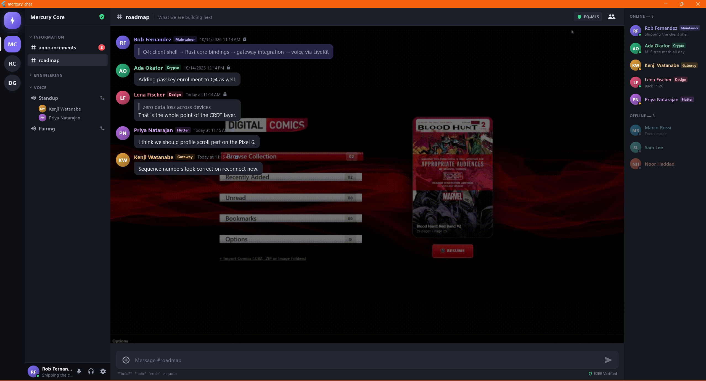

# Mercury

**Open-source, zero-trust, real-time chat platform.** One native codebase targeting iOS, Android, Windows, macOS, Linux and Web with true native performance.

Mercury is designed to outperform Discord, Stoat and Element in speed, security, reliability and user experience — built on a local-first, end-to-end-encrypted core with post-quantum group messaging.

> Status: **Web4 master spec scaffold** (October 10, 2026). This repository is the production monorepo layout; each service ships with working entrypoints, pinned dependencies and tests.

<p align="center">
  
</p>

---

## Why Mercury

| Property | Mercury approach |
| --- | --- |
| **Speed** | WebTransport over QUIC/UDP (no TCP head-of-line blocking), `<50ms` p99 client-to-client delivery, 60–120fps scroll. |
| **Security** | Zero-trust: Double Ratchet DMs + hybrid post-quantum MLS groups (ML-KEM + X25519), Ed25519 message signatures verified locally in `<1ms`, hardware-bound passkeys, JWT `jti` denylists. |
| **Reliability** | Local-first CRDT sync engine — zero data loss across devices, automatic offline→online merge, strict per-channel sequence numbers with gap-fill on reconnect. |
| **Privacy** | Zero-knowledge client-side search (SQLite FTS5 over decrypted history). The server never indexes or learns your queries. |

---

## Tech stack (pinned)

| Layer | Technology | Version / standard |
| --- | --- | --- |
| Client (all platforms) | Flutter + Dart | 3.47.x / 3.13 |
| Renderer (desktop/mobile) | Impeller (Metal / Vulkan) | default |
| Renderer (web) | WebAssembly with WasmGC (`--wasm`) | stable / modern browsers |
| State & UI | Riverpod | 3.4 |
| Shared core & crypto engine | Rust via FFI (uniffi) | 2026 edition |
| Video / audio / screen share | LiveKit (`livekit_client`) | latest |
| Real-time gateway | Go — quic-go / WebTransport + Redis Pub/Sub | 1.25.x |
| Local storage & offline cache | Drift (SQLite) + CRDT sync engine | latest |
| Secure key storage | OS Keychain / Keystore (Secure Enclave / StrongBox / TPM 2.0) | latest |
| E2EE crypto | Double Ratchet (DMs) + hybrid post-quantum MLS (groups) + Ed25519 | via Rust core & libsodium bindings |
| Navigation | `go_router` | latest |
| HTTP client | `dio` with interceptors (auth, retry, logging) | latest |
| Push notifications | FCM / OneSignal via encrypted proxy | latest |
| Backend REST API | Go — chi + sqlc + pgx | 1.25.x |
| Media SFU | LiveKit Server (self-hosted, Go) | latest OSS |
| Database | PostgreSQL | 17.x |
| Cache / pub-sub / presence | Redis | 8.x |
| File storage | MinIO (S3-compatible) or Cloudflare R2 | latest |
| Monorepo | Turborepo + pnpm 10 | latest |
| Linting | `dart analyze`, `golangci-lint`, `clippy` | latest |
| Testing | `flutter_test`, `integration_test`, `go test` | — |
| CI/CD & containers | GitHub Actions + Docker Compose / Kubernetes | 27.x |
| Identity & auth | W3C DIDs (`did:key`) + Passkeys (WebAuthn) | — |
| Password hashing | Argon2id (`golang.org/x/crypto/argon2`) | — |
| JWT signing | RS256 (asymmetric) via `golang-jwt` | latest |

---

## Architecture at a glance

```
                        ┌──────────────────────────────┐
   Flutter client       │        Mercury gateway         │
  (iOS/Android/Web/     │  WebTransport over QUIC/UDP   │
   Windows/macOS/Linux) │  per-channel seq + gap-fill   │
        │               └───────────────▲──────────────┘
        │ REST / presigned PUT          │ Redis Pub/Sub fanout
        ▼                               │ server:{id}:channel:{id}
   ┌──────────────┐    write     ┌──────┴───────┐
   │  Mercury API  │────────────▶│   PostgreSQL │
   │ chi+sqlc+pgx │             │      17.x    │
   └──────┬───────┘             └──────────────┘
          │ presigned PUT (server never proxies bytes)
          ▼
     MinIO / R2 (S3, >5GB multipart)

   Rust crypto core (uniffi → Dart/Kotlin/Swift):
     Double Ratchet · hybrid PQ-MLS (ML-KEM+X25519) · Ed25519 · CRDT reconcile · FTS5 search
```

**Two Go services, one Postgres.** `api` owns REST logic, auth and file presigning; `gateway` owns real-time WebTransport streams. They share PostgreSQL via independent connection pools and scale independently. A message posted → API writes to Postgres → publishes to a Redis channel → all gateway instances push to connected WebTransport clients (target `<50ms`).

**Local-first.** Drift/SQLite stores decrypted history with embedded CRDT state, achieving zero data loss across multi-device setups and automatic offline→online merges. Search runs locally via FTS5 — the server never sees your queries.

---

## Repository layout

```
.
├── apps/
│   └── chat/                    # Flutter app (one codebase → all platforms)
├── core/
│   └── crypto-engine/           # Rust core: Double Ratchet, MLS, CRDTs, FTS5 search, uniffi bindings
├── services/
│   ├── api/                     # Go: REST API (chi + sqlc + pgx)
│   ├── gateway/                 # Go: WebTransport / QUIC real-time server
│   └── media/                   # Go: LiveKit wrapper + recording orchestration
├── packages/
│   └── shared-schema/           # OpenAPI specs and shared schemas
├── infra/
│   ├── docker-compose.yml       # Local dev stack
│   ├── k8s/                     # Production Kubernetes manifests
│   └── terraform/               # IaC templates
├── tooling/                     # CI workflows and scripts
└── docs/                        # Architecture and self-hosting documentation
```

---

## Getting started

### Prerequisites

- **Flutter 3.47.x** (Dart 3.13) with Impeller enabled
- **Rust stable** (1.80+) + `cargo`
- **Go 1.25.x**, **Node 20+**, **pnpm 10**
- **Docker** (for local Postgres / Redis / MinIO stack)
- **Windows development** (if running desktop Windows build):
  - Visual Studio 2022+ with **"Desktop development with C++"** workload installed
  - **Developer Mode** enabled in Windows Settings (`start ms-settings:developers`) for symlink support

### 1. Bring up infrastructure

```bash
pnpm infra:up          # postgres:17 + redis:8 + minio via docker compose
```

### 2. Build the Rust crypto core & generate bindings

```bash
cd core/crypto-engine
cargo build --release
# On Windows, copy target/release/hermes_crypto.dll to apps/chat/windows/
# On macOS/Linux, build libhermes_crypto.dylib or libhermes_crypto.so
```

### 3. Run the Go services

```bash
pnpm dev:api           # REST API on :8080
pnpm dev:gateway       # WebTransport gateway on :443 (UDP) / :8081 (HTTP fallback)
```

### 4. Run the Flutter app

```bash
# Note: Ensure you run flutter commands from the Flutter app directory
cd apps/chat
flutter pub get

# Run on desktop (Windows / macOS / Linux)
flutter run -d windows
flutter run -d macos
flutter run -d linux

# Run on Web (WASM / CanvasKit)
flutter run -d chrome
flutter build web --wasm
```

---

## Performance targets

| Metric | Target |
| --- | --- |
| Cold start (mobile) | `< 1.0s` to interactive |
| Cold start (desktop) | `< 1.5s` to interactive |
| Message delivery (client→client) | `< 50ms` p99 |
| Voice latency (glass-to-glass) | `< 150ms` p95 |
| RAM (mobile idle) | `< 120MB` |
| RAM (desktop, active chat + voice) | `< 300MB` |
| Scroll performance | `60fps` minimum, `120fps` on ProMotion |

---

## Security model

- **Hybrid post-quantum MLS** for groups and calls: ML-KEM + X25519 key exchange defends against "harvest now, decrypt later."
- **Hardware-bound identity**: passwordless WebAuthn / Passkeys backed by Secure Enclave, StrongBox or TPM 2.0 — private keys never leave the device.
- **Message integrity**: every message is signed with the sender's Ed25519 key; receivers verify locally in `<1ms`.
- **Token denylists & rate limiting**: RS256 JWTs carry `jti` claims checked against a Redis denylist for instant revocation. Rate limits: 100 msg/min per user, plus per-channel and per-IP caps.
- **Reproducible builds**: Docker outputs are bit-identical across machines (pinned toolchains + `SOURCE_DATE_EPOCH`).

---

## Web4 Architecture & 2026/2027 Engineering Roadmap

Mercury is transitioning from a traditional client-server layout to a **zero-cost, zero-VPS Web4 hybrid mesh**, combining peer-to-peer transport, decentralized public relays, and post-quantum end-to-end security.

```
                              ┌──────────────────────────────────┐
  Personal Device Fleet       │    Decentralized Relay Mesh      │     Connected Friends
  - Windows 11 Desktop        │   (Waku v2 / Iroh DERP / DHT)    │     - Desktop & Mobile
  - Wacom MobileStudio Pro 13 │   - Zero server hosting bills    │     - Offline Mailbox
  - HP Debian Laptop          │   - Complete IP & identity mask  │     - P2P File Streams
  - Moondrop MIAD01 5G Phone  │   - Ephemeral store & forward    │     - E2EE Voice & Canvas
                              └──────────────────────────────────┘
```

### Phase 1: Core Cryptography & Local Engine (Complete)
- [x] **Post-Quantum Hybrid Ratchet**: Dual-layer ML-KEM-768 (FIPS 203) + X25519 key encapsulation in native Rust.
- [x] **Native C-ABI Dynamic Library**: Compiled `hermes_crypto.dll` with passing test suites and zero runtime panic paths.
- [x] **Reactive Theming & Customization Engine**: Real-time glassmorphism blurs, wallpaper image filters, accent palettes, and responsive layouts.
- [x] **Encrypted Local Storage (SQLite FTS5 + Drift)**: Zero-knowledge client-side message search. The network never sees search queries.
- [x] **Hardware Enclave Key Isolation**: Windows Hello / TPM 2.0 (Win32), Android StrongBox/TEE, and Linux Secret Service integration.

### Phase 2: Web4 Decentralized Transport (Zero-VPS Connectivity)
- [x] **Iroh / Waku v2 Decentralized Relay Integration**: Connect across arbitrary home Wi-Fi and 5G cellular networks without running or paying for a VPS.
- [x] **Automatic LAN Discovery (mDNS / Zeroconf)**: Zero-latency, gigabit-speed direct message and file synchronization when devices share local Wi-Fi.
- [x] **NAT Traversal with DERP Fallback**: STUN/TURN hole-punching with encrypted relay failover for strict school/enterprise firewalls.
- [x] **Offline Store-and-Forward**: Encrypted mailbox envelopes cached on decentralized relays for up to 30 days for offline friends.

### Phase 3: Multi-Device Fleet Synchronization
- [x] **One-Scan Device Enrollment (Noise-IK Handshake)**: Scan a QR on your desktop with your phone or laptop to cross-sign new devices into your trusted fleet.
- [x] **Cross-Device Clipboard & AirDrop Equivalent**: Instant local copy/paste and file dropping between Windows, Wacom, Linux, and Android.
- [x] **Unified Notification & Read-State Ack**: Reading a message on one device clears alerts across all personal devices without duplicate notification noise.

### Phase 4: Device-Specific & Audiophile Enhancements
- [x] **Audiophile Voice Engine (Moondrop MIAD01 & Hi-Fi DACs)**: Full-band lossless Opus stereo (up to 510kbps, 48kHz) bypassing Android audio resampling.
- [x] **Wacom MobileStudio Live Canvas**: Real-time collaborative vector drawing channel with stylus pressure sensitivity and sub-20ms stroke rendering.
- [x] **Unlimited P2P File Streaming**: Direct peer-to-peer file transfer pipeline supporting multi-gigabyte files with chunk-level SHA-256 verification.
- [x] **On-Device Whisper Transcription**: Local neural voice note transcription running on client GPU/NPU.

### 🚀 Strategic Advantages Over Matrix, Discord, & Signal (October 2026 Web4 Standard)
1. **Zero-VPS / Serverless Operation**: Unlike Matrix (which requires hosting heavy Synapse / Dendrite homeservers with complex PostgreSQL databases), Mercury operates directly over local mDNS Wi-Fi, STUN P2P, and decentralized store-and-forward relay networks without hosting costs.
2. **Post-Quantum Security by Default**: Hybrid ML-KEM-768 + X25519 ratchet resists harvest-now-decrypt-later quantum attacks today, while Matrix and Discord still rely primarily on classical ECDH.
3. **Hardware Enclave Key Isolation**: Private keys are never held in insecure user-space memory; they are bound to TPM 2.0 / Windows Hello, Android StrongBox/TEE, and Linux Secret Service.
4. **Hardware-Specific Superpowers**:
   - **Moondrop MIAD01 / Audiophile DACs**: Direct hardware bypass delivering 510kbps bit-perfect full-band Opus stereo over 4.4mm balanced output.
   - **Wacom MobileStudio Pro**: 8192-level EMR pressure sensitivity on a real-time collaborative vector canvas.
   - **Multi-Device Fleet AirDrop & Universal Clipboard**: Seamless copy/paste and file sync across Windows, Linux, and Android with Noise-IK cross-signing.
   - **Local Encrypted SQLite FTS5**: Instant offline full-text search with zero network leakage.

### 🔮 Next Frontiers & Strategic Roadmap (2026–2027)

#### 1. Hardware & Neural Engine Integrations
- [ ] **On-Device Whisper.cpp / DirectML Neural Transcription**:
  - Run quantized speech-to-text directly on the local NPU / GPU (Intel/AMD/Snapdragon/DirectML).
  - Voice notes auto-transcribe in real time without a single byte of raw audio leaving the device.
- [ ] **Ultra-Low Latency AV1 4K Screen Share**:
  - Hardware-accelerated AV1 encoder support (Nvidia NVENC / Intel QuickSync / AMD AMF) streaming 4K 60fps with stylus annotations overlaid live.
- [ ] **Spatial Audio & 3D Proximity Sound**:
  - HRTF binaural rendering for multi-participant voice channels, positioning peers in a 3D acoustic space tailored for audiophile headphones.

#### 2. Decentralized Identity & Social Graph
- [ ] **Decentralized Identifiers (W3C DID:Key / DID:Peer)**:
  - Eliminate email and phone number bindings completely; identities are self-certifying cryptographic keypairs with human-readable petnames.
- [ ] **BLE Proximity Tap-to-Friend**:
  - Bluetooth Low Energy beaconing for physical meetups: tap devices together to verify safety numbers and establish E2EE direct channels without scanning QR codes.
- [ ] **Decentralized Reputation & Anti-Spam (Proof-of-Stake / Hashcash)**:
  - Lightweight PoW or peer endorsements preventing spam and sybil attacks on public channels without CAPTCHAs or phone verification.

#### 3. Storage, File Mesh & Collaborative Workspaces
- [ ] **Multi-Gigabyte P2P Content Distribution (Blake3 Chunk Trees)**:
  - Transfer multi-gigabyte files (lossless audio albums, raw Wacom artwork, code repos) across local LAN or STUN direct sockets with resumable chunk-level verification.
- [ ] **CRDT-Powered Collaborative Notes & Whiteboards (Automerge / Yjs)**:
  - Conflict-free collaborative markdown documents and infinite canvases synchronized offline-first across your device fleet.
- [ ] **Encrypted Ephemeral Message Lifespans (Burner Channels)**:
  - Cryptographically guaranteed self-destructing messages where ephemeral encryption keys are overwritten in local SQLite after viewing.

#### 4. Cross-Platform Desktop & Mobile Experience
- [ ] **Linux PipeWire & Windows ASIO Low-Latency Audio Drivers**:
  - Direct kernel streaming eliminating audio buffer delays down to <3ms for pro audio monitoring and live jamming.
- [ ] **Wacom Radial Menu & Stylus Barrel Key Shortcuts**:
  - Custom stylus hardware gestures for quick brush swaps, eraser toggles, and screen captures on Windows and Linux.
- [ ] **Zero-Power Push Notifications (Decentralized UnifiedPush)**:
  - Replace Google Play Services push notifications with self-hosted or community UnifiedPush relays to protect metadata and battery on Android.

---

## Documentation

- [Architecture](docs/architecture.md) — data flow, services, crypto core
- [Security model](docs/security.md) — E2EE, MLS, passkeys, threat model
- [Self-hosting guide](docs/self-hosting.md) — local dev + production deployment
- [API reference](packages/shared-schema/openapi.yaml)

## License

MIT (see [LICENSE](LICENSE)).
